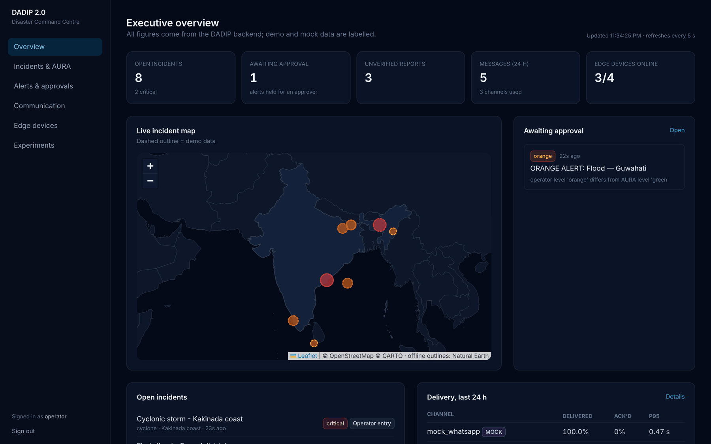
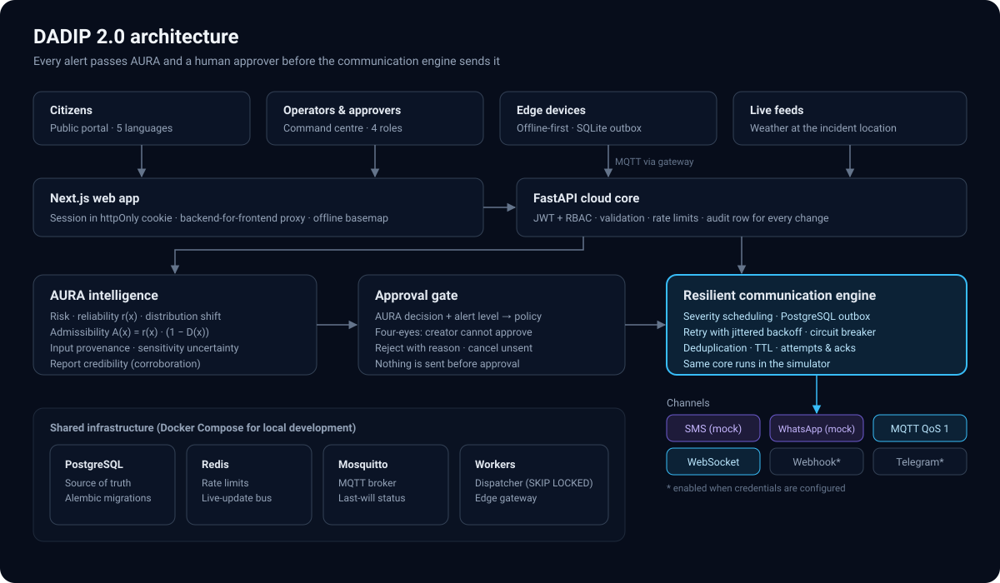
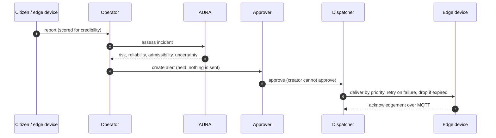
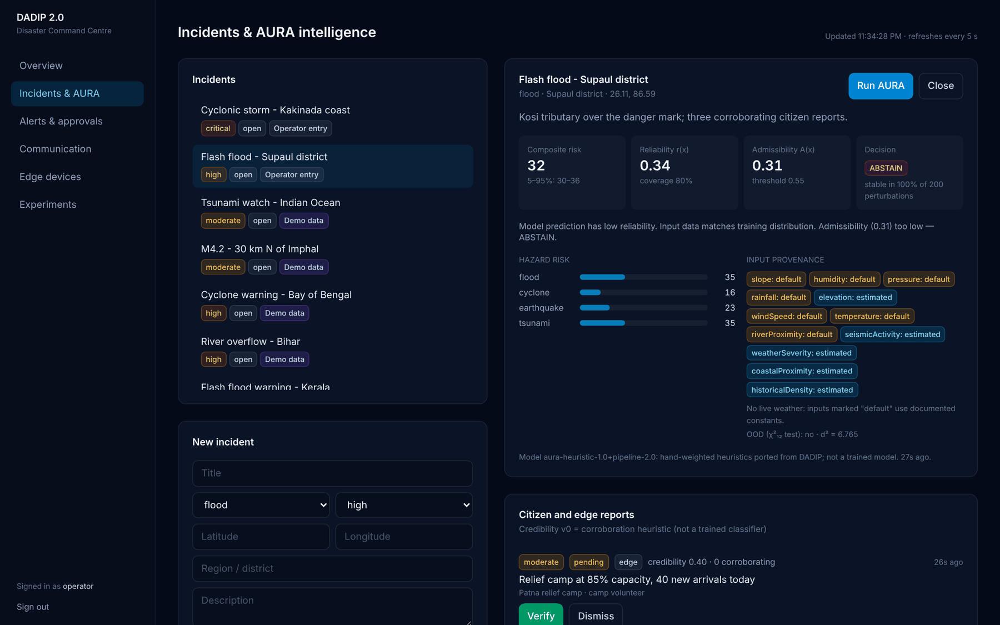
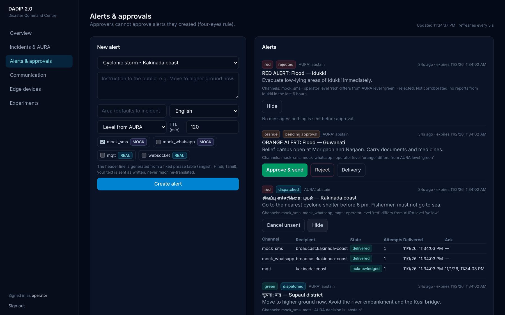
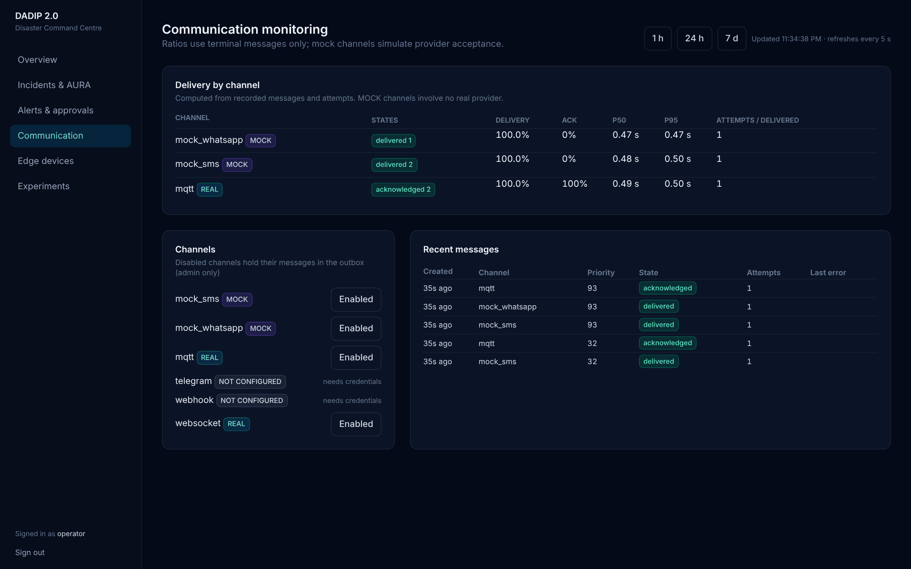
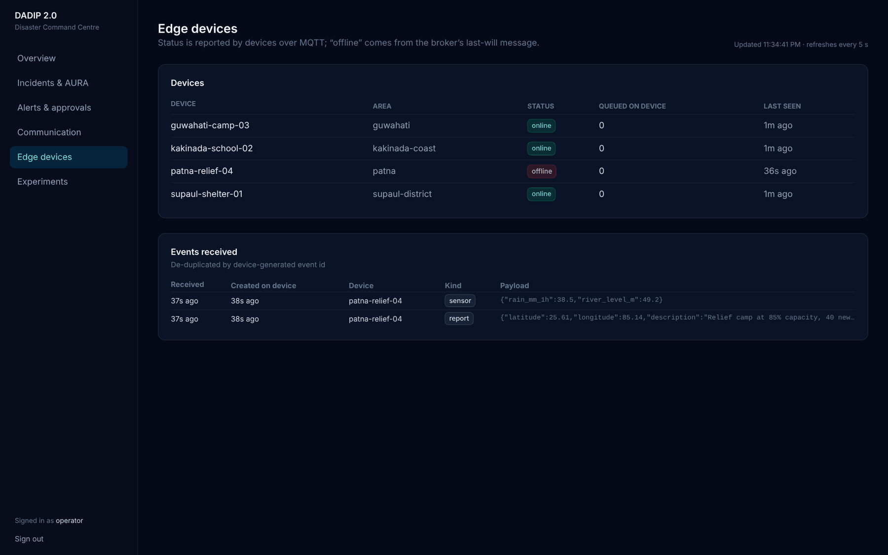
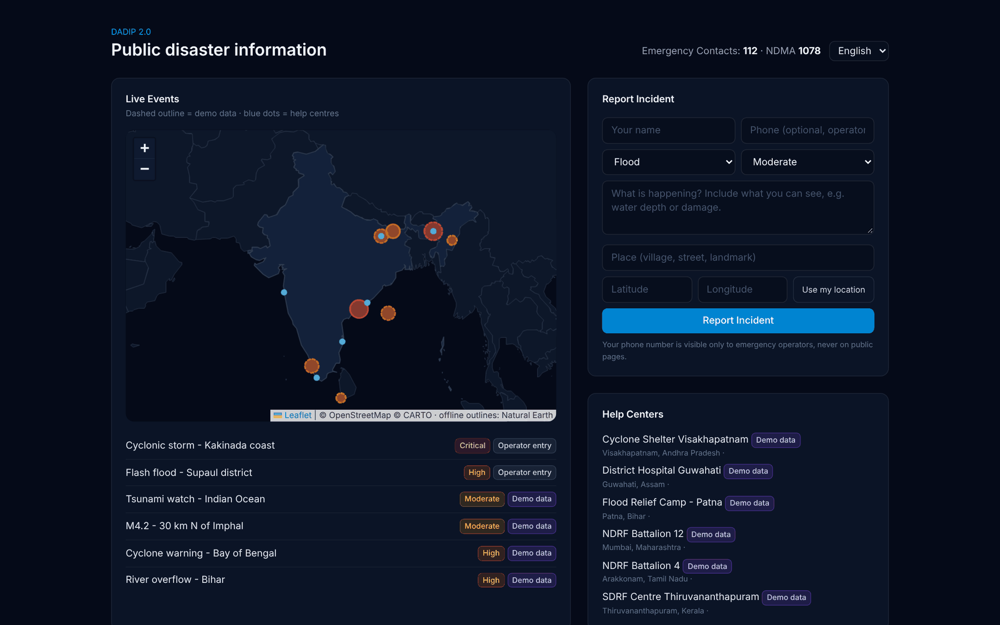
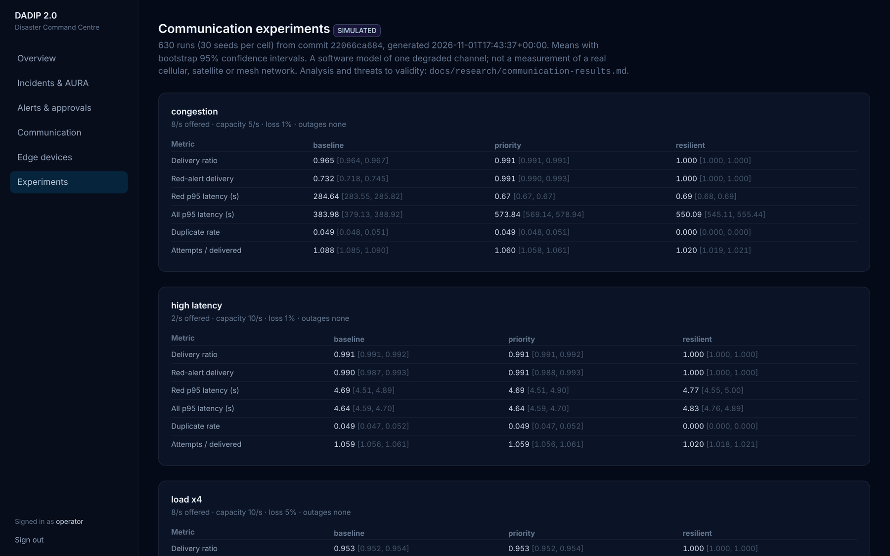
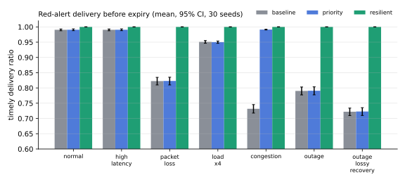

<div align="center">

# DADIP 2.0

### Distributed AI-Driven Disaster Intelligence & Resilient Communication Platform

Disaster intelligence that keeps critical alerts moving when networks degrade.

[](https://github.com/Megavarshan/dadip-2.0/actions/workflows/ci.yml)




</div>

---

## Why DADIP 2.0

During disasters the information that matters most is often the hardest to deliver: cellular networks congest,
power and links fail, citizen reports arrive unverified, and warnings from several agencies conflict. Most
disaster dashboards focus on showing data. DADIP 2.0 focuses on **deciding what deserves action and getting
that message through**:

- **Assess** every incident with an uncertainty-aware AI engine (AURA) that says how far its own output can be trusted.
- **Gate** every high-impact alert behind a human approver, so unverified or low-confidence warnings are never broadcast automatically.
- **Deliver** alerts through a communication engine built for congestion and outages: severity scheduling, a durable outbox, retries, a circuit breaker, deduplication and expiry.
- **Keep working at the edge**: field devices record reports and receive alerts while offline, then synchronise exactly once when the link returns.

DADIP 2.0 is the successor to [DADIP](https://github.com/Megavarshan/disaster-ai). It keeps the original's
decision-admissibility idea and rebuilds the rest as a tested, event-driven cloud–edge system.

## Architecture



| Subsystem | What it does | Code |
| --- | --- | --- |
| **AURA intelligence** | Multi-hazard risk, reliability r(x), distribution-shift detection, decision admissibility A(x) = r(x)·(1 − D(x)), input provenance, sensitivity-based uncertainty, report credibility | `backend/dadip/aura` |
| **Cloud core** | FastAPI service, PostgreSQL with migrations, JWT and four roles, rate limits, an audit record for every change | `backend/dadip` |
| **Resilient communication engine** | Approval workflow, priority scheduling, outbox dispatcher, retry with backoff, circuit breaker, deduplication, TTL, delivery and acknowledgement tracking | `backend/dadip/comms` |
| **Edge network** | Offline-first agent (SQLite outbox, MQTT QoS 1, local risk inference) and an idempotent cloud gateway | `backend/dadip/edge` |
| **Command centre** | Operator console and multilingual public portal on the live API | `frontend` |
| **Network simulator** | Reproducible experiments comparing delivery strategies under degradation | `backend/dadip/simulation` |

## How an alert travels



## Screenshots

| | |
| --- | --- |
| <br>**AURA assessment** — risk, reliability, admissibility, uncertainty and the provenance of every input | <br>**Alerts and approvals** — multilingual headers, four-eyes approval, per-channel delivery and acknowledgement |
| <br>**Communication monitoring** — delivery computed from recorded attempts; mock channels are labelled | <br>**Edge devices** — live status over MQTT, offline detection, de-duplicated events |
| <br>**Public portal** — incident map with an offline basemap, help centres, citizen reporting in five languages | <br>**Experiments** — simulation results with 95% confidence intervals |

## Results

The communication engine was evaluated in a seeded discrete-event simulation: 7 network scenarios × 3 strategies
× 30 seeds (630 runs). The simulator calls the same scheduling code as the live dispatcher.

| Metric (mean of 30 seeds) | Baseline (FIFO) | Priority | Resilient |
| --- | ---: | ---: | ---: |
| Red alerts delivered before expiry — 120 s outage | 0.790 | 0.791 | **1.000** |
| Red alerts delivered before expiry — 20% packet loss | 0.822 | 0.823 | **1.000** |
| Red alerts delivered before expiry — congestion (8/s into 5/s) | 0.732 | 0.991 | **1.000** |
| Red-alert p95 latency — congestion | 284.6 s | **0.67 s** | 0.69 s |
| Duplicate alerts shown to users, per alert — congestion | 0.049 | 0.049 | **0** |



**Reading these numbers honestly:** the results come from a software model of one degraded channel, not from a
cellular or radio network. Resilient delivery has a cost: alerts that other strategies drop arrive later
(red p95 of 89 s during a 120 s outage). Full tables, method and threats to validity:
[`docs/research/communication-results.md`](docs/research/communication-results.md).

## Engineering highlights

- **Parity-tested AI port.** The original TypeScript AURA engines were ported to Python and checked against the
  original code on 745 cases; every output field matches.
- **Findings from the original model.** Global optimisation shows the original admissibility score never exceeds
  0.48, so its "execute" decision (≥ 0.55) is unreachable; DADIP 2.0 therefore routes every alert to a human. The
  original out-of-distribution threshold was applied on the wrong scale; a corrected χ² test runs alongside it.
- **Exactly-once at the edge.** Edge events are acknowledged by the broker before they leave the device outbox and
  de-duplicated by device-generated ids in the cloud; tested with real link outages through a TCP fault proxy.
- **Safe concurrency.** Several dispatchers can run at once (`FOR UPDATE SKIP LOCKED`); a test with four workers
  and forty messages records exactly forty attempts.
- **Defects found by testing, fixed with regression tests:** an edge-agent deadlock after reconnection, lost MQTT
  acknowledgements under fast replies, and retry-budget exhaustion of red alerts during outages.

## Tech stack

| Layer | Technology |
| --- | --- |
| Backend | Python 3.12, FastAPI, Pydantic v2, SQLAlchemy 2, Alembic, psycopg 3 |
| Data | PostgreSQL 16, Redis 7 |
| Messaging | Eclipse Mosquitto (MQTT 3.1.1, QoS 1), WebSocket, webhooks |
| AI / analysis | NumPy, AURA heuristic engines, seeded simulation, bootstrap statistics |
| Frontend | Next.js 16, React 19, TypeScript, Tailwind CSS 4, Leaflet with an offline Natural Earth basemap |
| Edge | Python agent, SQLite, paho-mqtt |
| Quality | pytest (unit + integration on real services), Playwright, Ruff, ESLint, GitHub Actions |

## Getting started

### Requirements

Python 3.12+, Node.js 22+, PostgreSQL 16, Redis 7 and Mosquitto 2, or Docker Compose for the services.

### 1. Backend

```bash
cd backend
python -m venv .venv && source .venv/bin/activate
pip install -e ".[dev]"
cp ../.env.example ../.env            # then set DADIP_JWT_SECRET
alembic upgrade head
python -m dadip.seed --admin-email you@example.com --demo   # prints a generated admin password once
uvicorn dadip.main:app --reload       # API docs at http://localhost:8000/api/docs
```

### 2. Workers and an edge device

```bash
dadip-dispatcher                                       # sends approved alerts, records acknowledgements
dadip-edge-gateway                                     # receives edge device events
dadip-edge --device-id shelter-01 --area supaul-district   # optional simulated field device
```

### 3. Command centre

```bash
cd frontend
npm ci
DADIP_API_URL=http://localhost:8000 npm run dev        # http://localhost:3000
```

Sign in at `/login` with an operator, approver or admin account. Citizens use `/public` without an account.

### 4. Experiments

```bash
cd backend
pip install -e ".[research]"
dadip-sim --seeds 30 --out ../simulation-results/latest
python -m dadip.simulation.figures ../simulation-results/latest
```

## Project structure

```
dadip-2.0/
├── backend/
│   ├── dadip/
│   │   ├── api/          REST routes, schemas, auth dependencies
│   │   ├── aura/         AI engines, assessment pipeline, credibility, weather
│   │   ├── comms/        scheduling core, adapters, dispatcher, alert service
│   │   ├── edge/         edge agent, local storage, cloud gateway
│   │   ├── simulation/   network simulator, experiments, figures, fault proxy
│   │   ├── db/           models and sessions
│   │   └── core/         configuration, security, logging
│   ├── migrations/       Alembic migrations
│   └── tests/            unit, integration and parity tests
├── frontend/             Next.js command centre and public portal
├── simulation-results/   committed experiment outputs (CSV, JSON, report, figures)
├── docs/                 architecture, research notes, development guide, status, dev log
├── infrastructure/       broker configuration
└── legacy/               original DADIP agent and SQL, kept for reference
```

## Testing

```bash
cd backend && ruff check . && pytest          # unit + integration (needs PostgreSQL, Redis, Mosquitto)
cd frontend && npx tsc --noEmit && npx eslint src && npx next build
```

The backend suite migrates a fresh test database with the real migrations and runs against real PostgreSQL,
Redis and Mosquitto. CI runs the same checks on every push.

## Documentation

| Document | Contents |
| --- | --- |
| [Communication results](docs/research/communication-results.md) | Experiment design, results, limitations |
| [AURA](docs/research/aura.md) | What the AI engine is, parity verification, findings |
| [Communication engine](docs/architecture/communication.md) | Alert lifecycle and the guarantees, each with its test |
| [Development guide](docs/development.md) | Services, migrations, tests, conventions |
| [Feature status](docs/status.md) | Implemented, simulated and planned, with what verifies each |
| [Development log](docs/devlog.md) | What was built, verified and fixed, phase by phase |

## Status and roadmap

**Working today:** AURA assessment, approval workflow, the communication engine with MQTT and WebSocket delivery,
offline-first edge devices, the command centre and public portal, and the simulation experiments.

**Next:** load and security testing, cloud deployment, live fault-injected experiments on a real broker,
bursty-loss and multi-channel failover experiments, and a labelled evaluation of report credibility.

SMS and WhatsApp are mock channels until a provider is configured; Telegram and webhook channels activate when
their credentials are set. Demo, simulated and live data are labelled throughout the interface.

## Author

**Megavarshan A** — B.Tech Artificial Intelligence, SRM Institute of Science and Technology

## License

[Apache License 2.0](LICENSE)
