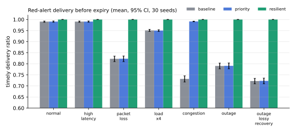
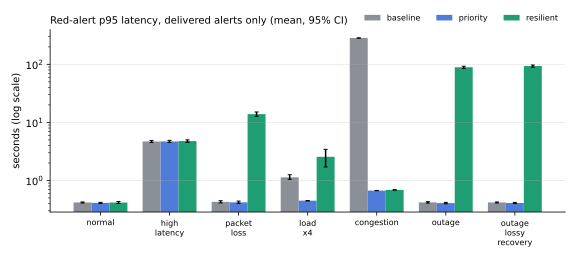
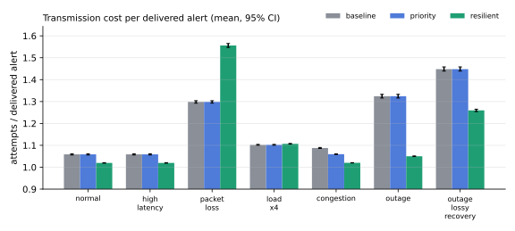

# Communication strategies under network degradation — results v1

**Source:** `simulation-results/v1/` (630 runs: 7 scenarios × 3 strategies × 30 seeds), generated by
`dadip-sim --seeds 30 --workers 2 --out ../simulation-results/v1` at commit `22066ca`. Full tables:
[`report.md`](../../simulation-results/v1/report.md); raw rows: `runs.csv`; configuration and environment:
`metadata.json`. Figures: `python -m dadip.simulation.figures ../simulation-results/v1`.

**Nature of the evidence:** a seeded discrete-event model of one alert channel (finite capacity, log-normal
latency, independent loss in each direction, outage windows). The scheduling decisions are made by the same
`dadip.comms.core` functions the live dispatcher runs. Nothing here is a measurement of a cellular, satellite,
5G or mesh network.

## Research question

Do severity-aware scheduling and resilience mechanisms (persistent outbox, retry with backoff, circuit breaker,
deduplication, TTL) improve the timely delivery of critical alerts when the channel degrades, and at what cost?

## Strategies

| | Order | Retry | Dedup | Holds messages during outage | TTL |
| --- | --- | --- | --- | --- | --- |
| baseline | arrival | no | no | no | no |
| priority | severity, then arrival | no | no | no | no |
| resilient | severity, then deadline | full-jitter backoff, 6 attempts | yes | yes (circuit breaker) | yes |

## Main results (means, bootstrap 95% CI, 30 seeds)

**1. Resilient delivered every alert before expiry in all seven scenarios** (1.000 [1.000, 1.000]).
Baseline lost alerts in proportion to the degradation: 0.809 with 20% loss, 0.793 with a 120 s outage,
0.725 with an outage plus 10% loss.

**2. Priority scheduling only matters when messages queue, and then it matters a great deal.** Under congestion
(8 alerts/s offered to a 5/s channel) red-alert p95 latency fell from 284.64 s (baseline) to 0.67 s (priority),
and red-alert timely delivery rose from 0.732 to 0.991. Without queueing (normal, high latency, loss, outage)
priority and baseline are statistically indistinguishable.

**3. Reliability is paid for in tail latency of the alerts that would otherwise be lost.** Resilient red-alert
p95 was 89.12 s in the outage scenario and 13.89 s with 20% loss, against ~0.4 s for baseline. This comparison
is not like for like: latency is measured over *delivered* alerts only, and baseline's low tail exists because
it drops every alert it cannot send at once. An alert delivered 89 s late during a 120 s outage is weighed
against one never delivered.

**4. Transmission cost.** With 20% loss resilient needed 1.556 attempts per delivered alert against 1.298 for
baseline (retries). During outages it needed fewer (1.050 vs 1.324): the circuit breaker stops attempting on a
channel known to be down.

**5. Duplicates.** With a 5% rate of duplicate submissions, baseline and priority showed users 0.040–0.049
duplicate alerts per unique alert; resilient showed none (sender dedup by idempotency key; receivers dedup
re-sends, as the edge inbox does).

**6. Recovery.** After a 120 s outage, resilient drained its backlog in 33.0 s [32.3, 33.7] (46.6 s with 10% loss).
Baseline "recovers" in 2.2 s only because it discarded the alerts raised during the outage.

**7. Stale alerts.** Under congestion baseline delivered 129.9 alerts per run *after* their expiry; priority and
resilient delivered none.

## Design defect found by the experiment

The first outage runs showed red alerts doing *worse* than average under the resilient strategy (red 0.982
against 0.998 overall, seed 1). Cause: while the circuit breaker was open, its probe used the next message in
priority order — always a red alert — and each failed probe spent that alert's retry budget until it was marked
failed. Fix: failures while the channel is known to be down return the message to the outbox without consuming
its budget (`after_attempt(..., channel_down=True)`), now used by both the simulator and the live dispatcher.
Regression tests: `test_red_alerts_survive_long_outage`, `test_channel_outage_holds_messages_without_burning_retries`.

## Threats to validity

- **Model, not network.** Loss is independent per message and direction; real links have correlated, bursty
  loss and asymmetric failure. Latency is log-normal; capacity is a single serial sender.
- **TTLs are generous** (red 5 min to green 20 min) and the simulation continues 25 min after arrivals stop.
  Shorter TTLs would reduce resilient's delivery ratio; this was not explored in v1.
- **Single channel.** No multi-channel failover was modelled, although the engine supports several channels.
- **Receiver deduplication** is assumed for the resilient strategy only, matching the DADIP edge agent; the
  duplicate comparison partly reflects that design choice.
- **Untuned parameters.** Breaker threshold (3), probe interval (5 s) and backoff (base 2 s, cap 120 s, 6
  attempts) were chosen once and not optimised.
- **Narrow intervals** come from 30 seeds of ~1,200–4,800 alerts each; they quantify simulation noise, not
  uncertainty about real-world performance.

## Next experiments

1. TTL sensitivity sweep (1–20 min) and offered-load sweep (0.5×–2× capacity).
2. Bursty (Gilbert–Elliott) loss instead of independent loss.
3. Multi-channel failover (SMS → MQTT → WebSocket).
4. Live fault-injected runs: real dispatcher + Mosquitto through `FaultProxy`, to compare with the model.
